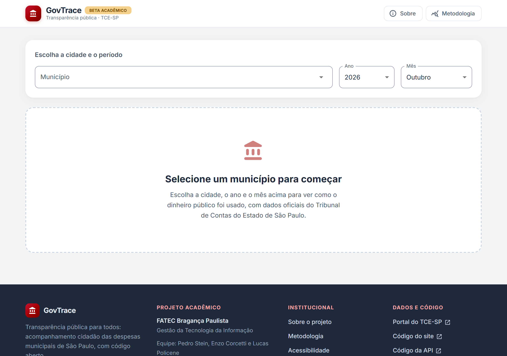
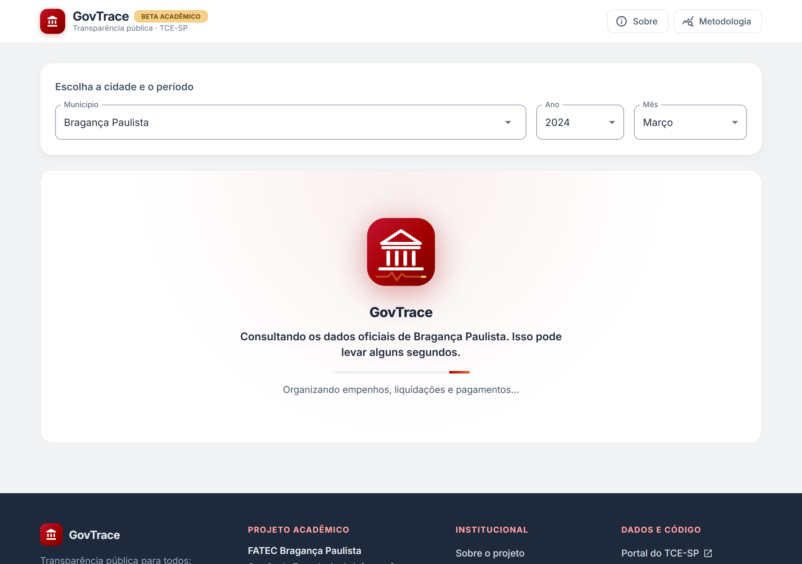
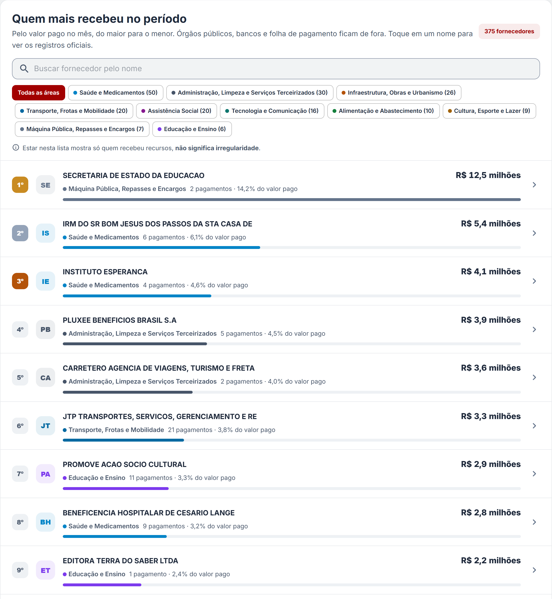
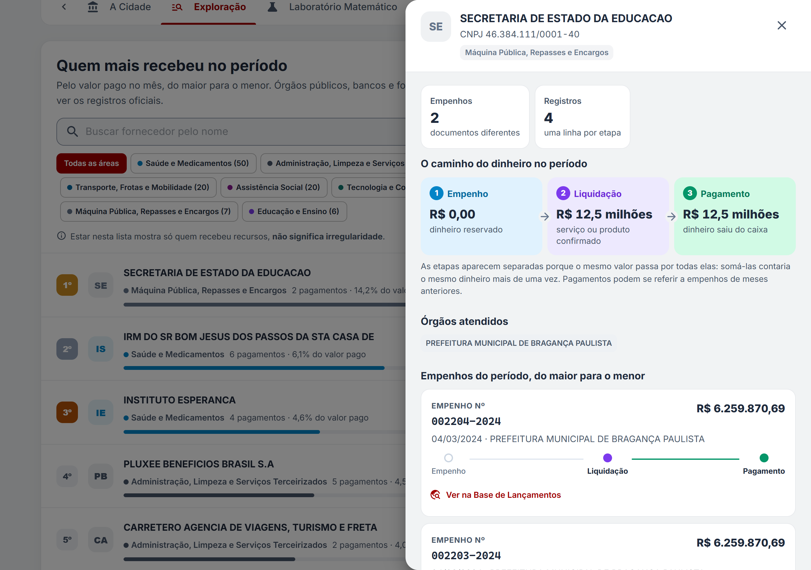
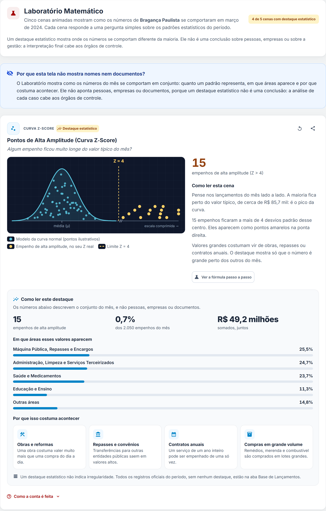
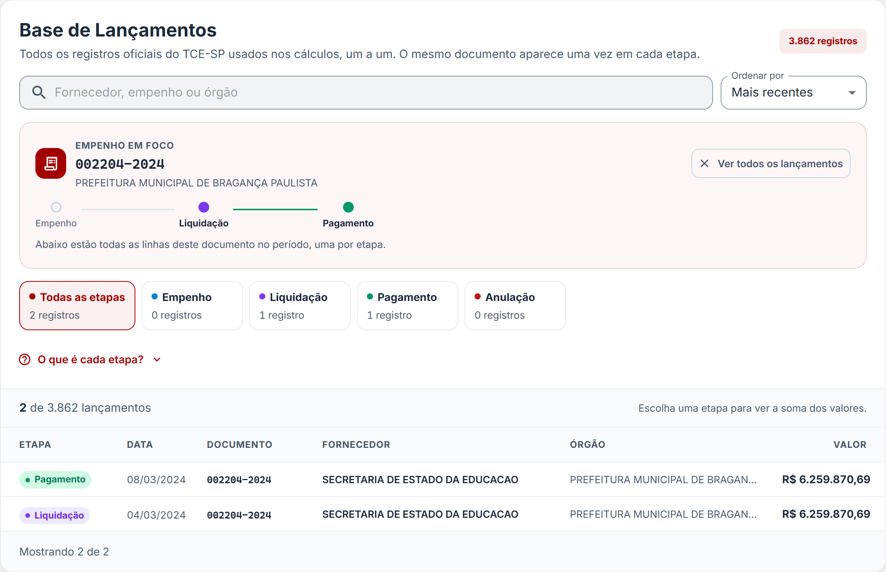
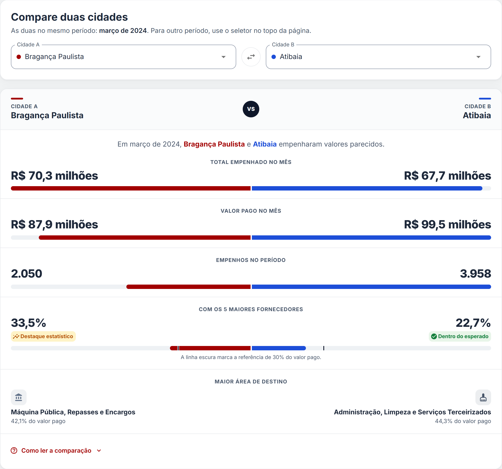
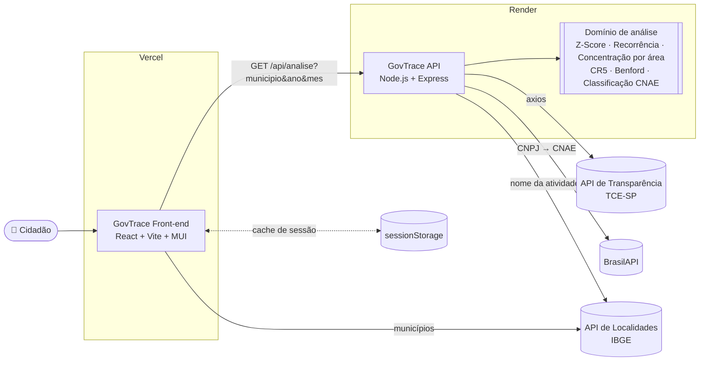

<div align="center">

# 🏛️ GovTrace — Transparência Pública para Todos

**Acompanhamento cidadão das despesas públicas municipais de São Paulo, com dados oficiais do TCE-SP.**

[](https://gov-trace.vercel.app)
[](https://github.com/Pedro6Stein/Govtrace-Api)


*Trabalho de Conclusão de Curso — Gestão da Tecnologia da Informação · FATEC Bragança Paulista*

</div>

---


## 📌 Sumário

- [Sobre o projeto](#-sobre-o-projeto)
- [Visão e propósito](#-visão-e-propósito)
- [Funcionalidades](#-funcionalidades)
- [Telas](#-telas)
- [Arquitetura](#-arquitetura)
- [Decisões de engenharia](#-decisões-de-engenharia)
- [Engenharia de software](#-engenharia-de-software)
- [Tecnologias](#-tecnologias)
- [Instalação](#-instalação)
- [Estrutura de pastas](#-estrutura-de-pastas)
- [Roadmap](#-roadmap)
- [Como contribuir](#-como-contribuir)
- [Equipe](#-equipe)
- [Licença](#-licença)

---

## 💡 Sobre o projeto

O Tribunal de Contas do Estado de São Paulo (TCE-SP) publica milhares de notas de empenho por município todos os meses. Os dados são públicos, mas chegam em um formato que praticamente só especialistas conseguem interpretar.

O **GovTrace** transforma esse volume de registros em **informação compreensível para qualquer cidadão**. Você escolhe o município e o período, e o sistema:

1. consulta os dados oficiais do TCE-SP (por meio da [GovTrace API](https://github.com/Pedro6Stein/Govtrace-Api));
2. aplica **cinco métodos estatísticos** (Z-Score, recorrência de valores, concentração por área, participação dos 5 maiores fornecedores — CR5 — e Lei de Newcomb-Benford);
3. apresenta os resultados em uma interface em que **o dado é o protagonista** e a explicação em linguagem cidadã fica a um clique de distância.

> ⚖️ **Princípio de neutralidade:** o GovTrace não acusa ninguém. Os métodos apontam **destaques estatísticos** (onde os números se comportam diferente da maioria), nunca conclusões jurídicas. No Laboratório Matemático, os credores aparecem só com uma identidade anônima. A interpretação final cabe aos órgãos de controle.

## 🌱 Visão e propósito

O GovTrace é um **projeto acadêmico em constante evolução**, construído desde o início com **foco em escalabilidade**: front-end e back-end são desacoplados, a lógica de análise vive em um domínio isolado e cada camada pode crescer de forma independente.

O código é **aberto** com dois objetivos claros:

- **Inspirar outros desenvolvedores** a usar tecnologia a favor do interesse público, mostrando na prática como transformar dados governamentais em ferramentas cívicas.
- **Engajar a sociedade na fiscalização pública**, colocando nas mãos do cidadão os mesmos métodos estatísticos usados por auditores.

Queremos **crescer rápido**. Por isso estamos estruturando a base para receber **parcerias institucionais e contribuições da comunidade**, como um projeto **Open Source de impacto social**. Se você é dev, designer, estatístico, jornalista de dados ou gestor público, há espaço para você aqui. Veja [Como contribuir](#-como-contribuir).

## ✨ Funcionalidades

| Aba | O que mostra |
|---|---|
| 🏛️ **A Cidade** | Total empenhado no mês, o caminho do dinheiro (empenhado, liquidado e pago, sem somar etapas), maior valor único, participação dos 5 maiores fornecedores (CR5) e divisão dos pagamentos por área pública, classificada pela atividade oficial das empresas (CNAE da Receita Federal) |
| 🔎 **Exploração** | Ranking dos fornecedores pelo valor pago, com busca por nome, filtro por área e painel com os registros de cada um, agrupados por empenho |
| 🧪 **Laboratório Matemático** | Cinco cenas animadas, uma por método estatístico, com fórmula passo a passo, imagem para compartilhar e o rastro de cada empenho (credores com identidade anônima) |
| 📄 **Base de Lançamentos** | Todos os registros oficiais do período, com busca, filtro e soma por etapa (empenho, liquidação, pagamento, reforço, anulação), ordenação e "empenho em foco" |
| ⚖️ **Comparação** | Duas cidades frente a frente no mesmo período, em um placar com barras espelhadas e explicação de como comparar |

Além disso:

- **Seleção de qualquer um dos 645 municípios paulistas**, com lista carregada dinamicamente da API do IBGE.
- **Explicação cidadã sob demanda**: cada indicador tem um "Entenda este dado" que revela, em linguagem simples, o que o número significa e qual método o gerou.
- **Carregamento animado** com o logotipo do GovTrace desenhado enquanto os dados do TCE-SP são consultados.
- **Metodologia** e **Acessibilidade** documentadas dentro do próprio site.

## 🖼️ Telas

### Tela inicial: seleção de município e período


### Carregamento: o logotipo desenhado enquanto os dados chegam


### A Cidade: panorama do mês


### Exploração: quem mais recebeu


### Registros de um fornecedor


### Laboratório Matemático: cenas animadas


### Base de Lançamentos: empenho em foco


### Comparação entre cidades


### Experiência mobile


## 🧱 Arquitetura

O GovTrace segue uma **arquitetura desacoplada**. Este repositório é a **camada de apresentação**: não faz nenhum cálculo, apenas consome a análise pronta da API e a exibe.



**Por que desacoplar?** Na primeira versão (monólito front-end), o navegador do cidadão baixava milhares de registros brutos e executava toda a estatística localmente. Ao mover a lógica para o back-end:

- o front ficou **mais leve e mais rápido**, com cerca de 600 linhas de lógica removidas do cliente;
- as regras de análise passaram a ter **uma única fonte da verdade**, testável isoladamente;
- a mesma API pode alimentar no futuro **outros clientes** (app mobile, bots, dados abertos para jornalistas).

## 🛠️ Decisões de engenharia

### ⚡ Cache de sessão resiliente (`sessionStorage`)

Cada análise consolidada (município + ano + mês) é guardada no `sessionStorage` do navegador. Voltar a um período já consultado é **instantâneo** e não gera nenhuma nova chamada à API.

A implementação foi pensada para **nunca derrubar a experiência**:

- **Tolerante a cota cheia:** cada análise ocupa cerca de 1 MB, e o `sessionStorage` tem limite de aproximadamente 5 MB. Leitura e escrita ficam protegidas por `try/catch`; se o cache estiver cheio ou corrompido, a consulta segue normalmente pela rede.
- **Escopo de sessão:** o cache expira sozinho ao fechar a aba, então o cidadão sempre recebe dados atualizados em uma nova visita.
- **Chave determinística e versionada:** `govtrace_analise_v2_{municipio}_{ano}_{mes}`. O `v2` invalida respostas guardadas no formato antigo sempre que o contrato da API muda.

### 🧮 Uma base para cada pergunta (sem dupla contagem)

O TCE-SP publica uma linha para cada etapa do mesmo empenho (empenho, liquidação, pagamento). Somar todas as linhas contaria o mesmo dinheiro até três vezes. Por isso, a API usa uma base para cada pergunta: o total do mês mostra cada etapa separada; o ranking, a divisão por área e o CR5 usam só os pagamentos; e os métodos estatísticos contam cada empenho uma vez. No site, a soma da Base de Lançamentos só aparece com uma etapa escolhida.

### 🎬 Motion com propósito e carregamento sob demanda

As animações explicam a informação (o logotipo desenhado durante a consulta, números que contam até o valor real, barras que crescem, a linha do tempo de um empenho) e são desligadas quando o sistema pede menos movimento. O Laboratório Matemático (Framer Motion) e a fórmula passo a passo (KaTeX) só são carregados quando o usuário abre essas telas, para não pesar a primeira visita.

### 🏁 Proteção contra *race conditions*

Se o usuário troca de filtro enquanto uma consulta ainda está em andamento, a requisição anterior é **cancelada com `AbortController`**. Isso impede que uma resposta antiga, que chegou atrasada, sobrescreva os dados do período atual.

### 📱 Design responsivo e acessível

- **Mobile-first com CSS Grid** e breakpoints do MUI (`xs`, `sm`, `md`): cards em coluna única no celular e em grade no desktop, com números longos protegidos contra overflow.
- **Divulgação progressiva:** o componente `ExplicacaoCidada` centraliza o padrão "botão + Collapse". O número aparece primeiro e a explicação vem quando o usuário pede.
- **Acessibilidade (ARIA):** os botões de expansão expõem `aria-expanded` e `aria-controls`. Tooltips, que não funcionam bem com toque nem com teclado, foram substituídos por conteúdo expansível.
- **Design system tonal** com a paleta institucional da FATEC, definido em um tema MUI único (`src/tema/tema.js`).
- **No celular**, a tabela da Base de Lançamentos vira um cartão por registro e a Comparação mantém as duas cidades lado a lado, sem rolagem lateral.

## 📚 Engenharia de software

A documentação completa de engenharia de software do GovTrace (site e API) está em **[docs/engenharia](./docs/engenharia/README.md)**: visão geral, requisitos funcionais e não funcionais, regras de negócio, casos de uso detalhados, diagramas UML (casos de uso, sequência, atividades, estados, classes, componentes e implantação), contrato da API, modelo de dados, decisões de arquitetura, plano de testes, matriz de rastreabilidade, riscos e gestão de configuração.

## 🧰 Tecnologias

| Categoria | Tecnologia |
|---|---|
| UI | [React 19](https://react.dev/) |
| Build / Dev server | [Vite 6](https://vite.dev/) |
| Componentes e tema | [Material UI 6](https://mui.com/) + [Emotion](https://emotion.sh/) · fonte [Inter](https://rsms.me/inter/) auto-hospedada |
| Animações | CSS (keyframes) e [Framer Motion](https://motion.dev/) no Laboratório Matemático |
| Fórmulas e imagens | [KaTeX](https://katex.org/) (fórmula passo a passo) · [html-to-image](https://github.com/bubkoo/html-to-image) (imagem para compartilhar) |
| Dados | [GovTrace API](https://github.com/Pedro6Stein/Govtrace-Api) · [API de Localidades do IBGE](https://servicodados.ibge.gov.br/api/docs/localidades) |
| Qualidade | ESLint 9 (react-hooks, react-refresh) |
| Deploy | [Vercel](https://vercel.com/) |

## 🚀 Instalação

### Pré-requisitos

- [Node.js](https://nodejs.org/) **20+**
- npm 10+

### Passo a passo

```bash
# 1. Clone o repositório
git clone https://github.com/Pedro6Stein/GovTrace.git
cd GovTrace

# 2. Instale as dependências
npm install

# 3. Rode em modo de desenvolvimento
npm run dev
```

Acesse **http://localhost:5173**.

### Variáveis de ambiente

| Variável | Descrição | Padrão |
|---|---|---|
| `VITE_API_URL` | Endpoint de análise da GovTrace API | `https://govtrace-api.onrender.com/api/analise` |

Sem nenhuma configuração, o front usa a API de produção. Para desenvolver com a [API rodando localmente](https://github.com/Pedro6Stein/Govtrace-Api#-instalação), crie um arquivo `.env.local`:

```env
VITE_API_URL=http://localhost:3333/api/analise
```

> ℹ️ Variáveis `VITE_*` são embutidas no bundle **no momento do build**. Na Vercel, faça um *redeploy* depois de alterá-las.

> ⏳ A API de produção roda no plano gratuito do Render e hiberna quando fica ociosa. A **primeira** consulta depois de um período parado pode levar cerca de 50 s (*cold start*).

### Scripts

| Comando | Descrição |
|---|---|
| `npm run dev` | Servidor de desenvolvimento com HMR |
| `npm run build` | Build de produção em `dist/` |
| `npm run preview` | Serve o build localmente |
| `npm run lint` | Análise estática com ESLint |

## 📁 Estrutura de pastas

```
src/
├── componentes/
│   ├── abaCidade/               # HeroCidade, GraficoDestino (rosca), CartaoConcentracao, áreas
│   ├── abaExploracao/           # RankingFornecedores, DrawerRegistros, LinhaEtapas
│   ├── abaLaboratorio/          # PainelLaboratorio, cenas animadas, TrilhaEmpenho, compartilhar
│   ├── abaLancamentos/          # TabelaLancamentos (tabela no computador, cartões no celular)
│   ├── abaComparacao/           # ComparacaoMunicipios (placar A × B)
│   ├── CarregamentoGovTrace/    # Carregamento animado com o logotipo
│   ├── ProvaMatematica/         # Fórmula passo a passo (KaTeX, carregada sob demanda)
│   ├── ExplicacaoCidada/        # Padrão reutilizável de divulgação progressiva
│   ├── SeletorPeriodo/          # Município (IBGE) + ano + mês
│   ├── ModalMetodologia/        # Como cada método é calculado
│   ├── ModalAcessibilidade/     # Declaração de acessibilidade
│   └── ...                      # Cabecalho, Rodape, Sobre, ContornoErro, TermometroRisco
├── paginas/Painel/              # Orquestra filtros, estado e as 5 abas
├── servicos/
│   ├── apiGovtrace.js           # Cliente da GovTrace API + cache de sessão
│   └── ibge.js                  # Lista de municípios de SP
├── utilitarios/                 # Formatadores, tradutor cívico, contagem animada
├── dados/configuracoes.js       # Configurações exclusivas de UI (anos/meses)
└── tema/                        # Design system (tema MUI e cores do Laboratório)
docs/
├── assets/                      # Prints usados neste README
└── engenharia/                  # Documento de engenharia de software
```

## 🗺️ Roadmap

- [x] Painel cidadão com 5 abas
- [x] Cinco métodos estatísticos com explicação cidadã
- [x] Arquitetura desacoplada (Front React + API Node.js)
- [x] Cache de sessão e cancelamento de requisições
- [x] Classificação oficial por atividade econômica (CNAE)
- [x] Laboratório Matemático com identidade anônima dos credores
- [x] Comparação entre municípios e imagem para compartilhar
- [x] Carregamento sob demanda das partes pesadas (Laboratório e fórmulas)
- [x] Contagem por etapa, sem somar o mesmo dinheiro mais de uma vez
- [ ] Série histórica: comparação entre meses e anos (pedida por 92,6% no questionário do TCC)
- [ ] Valores por habitante, para comparar cidades de tamanhos diferentes
- [ ] Exportação de relatórios (PDF/CSV)
- [ ] Compartilhamento de análises por link (filtros na URL)
- [ ] Testes automatizados de componentes
- [ ] Modo escuro

## 🤝 Como contribuir

Contribuições são **muito bem-vindas**, sejam de código, design, documentação, estatística ou ideias.

1. Faça um **fork** do projeto.
2. Crie uma branch descritiva: `git checkout -b feat/comparativo-mensal`
3. Faça commits seguindo o padrão **[Conventional Commits](https://www.conventionalcommits.org/pt-br/)**:
   - `feat:` nova funcionalidade · `fix:` correção · `refactor:` refatoração · `docs:` documentação · `chore:` manutenção
4. Garanta que `npm run lint` e `npm run build` passem.
5. Abra um **Pull Request** explicando o **porquê** da mudança, com prints se ela alterar a interface.

**Diretrizes do projeto:**

- 🗣️ **Linguagem neutra e não acusatória** em qualquer texto exibido ao cidadão.
- 🧮 **Nenhuma lógica de cálculo no front-end.** Regras de negócio pertencem à [GovTrace API](https://github.com/Pedro6Stein/Govtrace-Api).
- ♿ **Acessibilidade e mobile** não são opcionais: teste em telas pequenas e com teclado.

Encontrou um bug ou tem uma ideia? Abra uma [issue](https://github.com/Pedro6Stein/GovTrace/issues).

Tem interesse em uma **parceria institucional** (universidades, ONGs, observatórios sociais, órgãos de controle)? Entre em contato com a equipe.

## 👥 Equipe

| Integrante | Papel |
|---|---|
| **Pedro Stein** | Líder Técnico · Desenvolvedor Full-Stack |
| **Enzo Corcetti** | Desenvolvedor |
| **Lucas Policene** | Desenvolvedor |

**Orientadores:** Prof. Carlos Augusto Gomes e Profa. Viviane Ramalho de Azevedo
**Instituição:** FATEC Bragança Paulista, curso de Gestão da Tecnologia da Informação

## 📄 Licença

Distribuído sob a licença **MIT**. Veja o arquivo [`LICENSE`](./LICENSE) para mais detalhes.

Os dados exibidos são públicos e pertencem ao **Tribunal de Contas do Estado de São Paulo (TCE-SP)**. A lista de municípios é fornecida pelo **IBGE**.

---

<div align="center">

Feito com 🧡 por estudantes da FATEC Bragança Paulista, para que **todo cidadão possa fiscalizar o dinheiro público**.

</div>
