# Documento de Engenharia de Software — GovTrace

> **Especificação de requisitos e projeto de software** do GovTrace (site + API).
> Versão 1.0 · 23 de outubro de 2026

| | |
|---|---|
| **Projeto** | GovTrace — Transparência pública para todos |
| **Instituição** | Fatec Bragança Paulista · Curso Superior de Tecnologia em Gestão da Tecnologia da Informação |
| **Equipe** | Pedro Stein (líder técnico e desenvolvedor full-stack) · Enzo Corcetti · Lucas Policene |
| **Orientadores** | Prof. Carlos Augusto Gomes · Profa. Viviane Ramalho de Azevedo |
| **Repositórios** | [GovTrace (site)](https://github.com/Pedro6Stein/GovTrace) · [Govtrace-Api (API)](https://github.com/Pedro6Stein/Govtrace-Api) |
| **Em produção** | [gov-trace.vercel.app](https://gov-trace.vercel.app) · [govtrace-api.onrender.com](https://govtrace-api.onrender.com/api/status) |

---

## Sumário

1. [Introdução](#1-introdução)
2. [Visão geral do sistema](#2-visão-geral-do-sistema)
3. [Partes interessadas e perfis de usuário](#3-partes-interessadas-e-perfis-de-usuário)
4. [Requisitos funcionais](#4-requisitos-funcionais)
5. [Requisitos não funcionais](#5-requisitos-não-funcionais)
6. [Regras de negócio](#6-regras-de-negócio)
7. [Casos de uso](#7-casos-de-uso)
8. [Arquitetura](#8-arquitetura)
9. [Modelagem UML](#9-modelagem-uml)
10. [Contrato da API](#10-contrato-da-api)
11. [Modelo de dados](#11-modelo-de-dados)
12. [Decisões de arquitetura](#12-decisões-de-arquitetura)
13. [Qualidade e plano de testes](#13-qualidade-e-plano-de-testes)
14. [Segurança, privacidade e acessibilidade](#14-segurança-privacidade-e-acessibilidade)
15. [Implantação e operação](#15-implantação-e-operação)
16. [Processo e gestão de configuração](#16-processo-e-gestão-de-configuração)
17. [Matriz de rastreabilidade](#17-matriz-de-rastreabilidade)
18. [Riscos e limitações](#18-riscos-e-limitações)
19. [Glossário](#19-glossário)
20. [Histórico do documento](#20-histórico-do-documento)

---

## 1. Introdução

### 1.1 Propósito

Este documento descreve **o que o GovTrace faz, como foi construído e por quê**. Ele serve de referência para a equipe, para os orientadores e para a banca, e também para quem quiser contribuir com o projeto. Os requisitos, as regras de negócio e os diagramas descrevem o sistema **como ele está no código** em outubro de 2026.

### 1.2 Escopo

O GovTrace é uma aplicação web gratuita que mostra, em linguagem simples, como as prefeituras paulistas gastam o dinheiro público. Ele é formado por duas partes:

- **GovTrace Web** (este repositório): a interface, em React, publicada na Vercel.
- **GovTrace API** ([Govtrace-Api](https://github.com/Pedro6Stein/Govtrace-Api)): busca, limpa, classifica e analisa os dados, em Node.js, publicada no Render.

**Dentro do escopo:** despesas municipais publicadas pelo Tribunal de Contas do Estado de São Paulo (TCE-SP), consultadas por município e por mês, com cinco métodos estatísticos explicados ao cidadão.

**Fora do escopo:** licitações e editais, dados de outros estados, série histórica (comparação entre meses), armazenamento próprio dos dados e qualquer conclusão jurídica sobre pessoas, empresas ou gestores.

### 1.3 Convenções

| Prefixo | Significado | Prefixo | Significado |
|---|---|---|---|
| RF | Requisito funcional | UC | Caso de uso |
| RNF | Requisito não funcional | CT | Caso de teste |
| RN | Regra de negócio | ADR | Decisão de arquitetura |

Prioridades: **Essencial** (sem ele o sistema não cumpre o objetivo), **Importante** e **Desejável**.

### 1.4 Referências

- ISO/IEC/IEEE 29148:2018 — engenharia de requisitos (estrutura deste documento).
- Lei nº 4.320/1964 — etapas da despesa pública (empenho, liquidação e pagamento).
- Lei nº 12.527/2011 (Lei de Acesso à Informação) e Lei nº 13.709/2018 (LGPD).
- W3C — Web Content Accessibility Guidelines (WCAG) 2.1, nível AA.
- [API de Transparência do TCE-SP](https://transparencia.tce.sp.gov.br/) · [BrasilAPI](https://brasilapi.com.br/docs) · [API de Localidades do IBGE](https://servicodados.ibge.gov.br/api/docs/localidades) · [CNAE / CONCLA-IBGE](https://concla.ibge.gov.br/).

---

## 2. Visão geral do sistema

### 2.1 O problema

Os dados de despesas são públicos, mas difíceis de usar. No questionário aplicado pela equipe (122 respostas, de 5 a 7 de outubro de 2026):

- **45,9%** não fazem ideia de quanto a cidade arrecada e gasta;
- **59,0%** nunca tentaram acessar um portal de transparência;
- os principais obstáculos são **não saber onde procurar** (43,4%), **sites lentos ou confusos** (34,4%) e **falta de tempo** (32,8%).

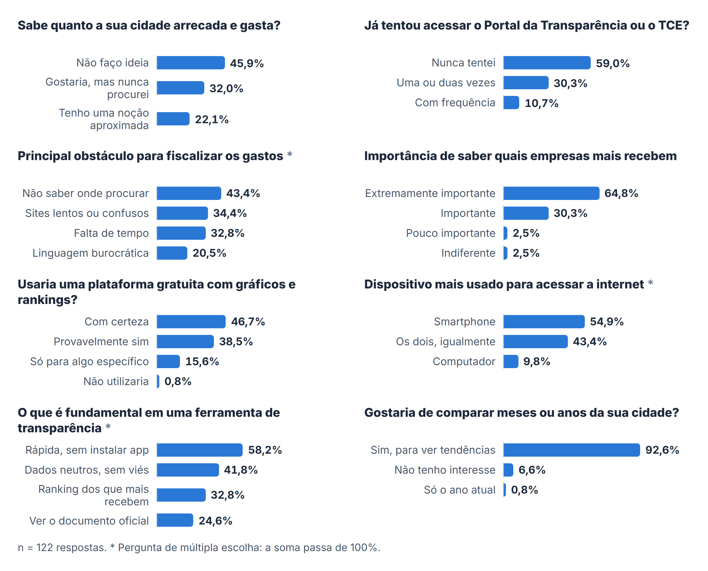

### 2.2 A solução

A pessoa escolhe o município, o ano e o mês, e o GovTrace organiza os registros oficiais em cinco abas:

| Aba | Pergunta que responde |
|---|---|
| **A Cidade** | Quanto foi empenhado, liquidado e pago no mês? Para onde foi o dinheiro? |
| **Exploração** | Quem mais recebeu? Quais são os registros de cada fornecedor? |
| **Laboratório Matemático** | Algum valor se comportou diferente da maioria? (cinco métodos estatísticos) |
| **Base de Lançamentos** | Quais são os registros oficiais, um a um? |
| **Comparação** | Como duas cidades se comparam no mesmo mês? |

### 2.3 Contexto

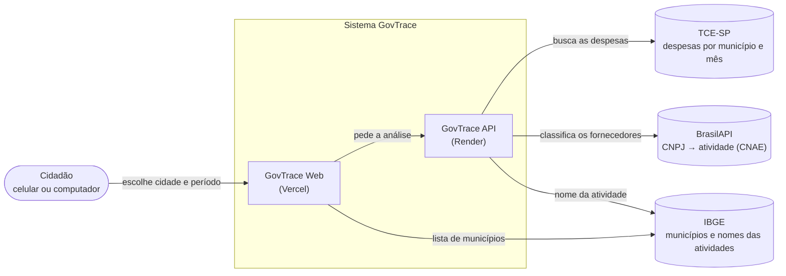

### 2.4 Restrições

- Os dados vêm **somente** do TCE-SP e dependem do prazo de publicação de cada município.
- A consulta é sempre **por município e por mês**.
- Não há banco de dados próprio: a análise é feita **no momento da consulta**.
- Hospedagem em planos gratuitos: a API “dorme” sem uso, e a primeira consulta depois disso pode levar **cerca de 50 segundos**.
- A BrasilAPI aceita cerca de 100 consultas por minuto; a classificação precisa respeitar esse limite.

### 2.5 Suposições e dependências

- A API de Transparência do TCE-SP continua disponível e com o mesmo formato de resposta.
- A BrasilAPI e o IBGE continuam gratuitos e públicos.
- O usuário usa um navegador atual (Chrome, Edge, Firefox ou Safari), no computador ou no celular.

---

## 3. Partes interessadas e perfis de usuário

### 3.1 Partes interessadas

| Parte interessada | Interesse |
|---|---|
| Cidadão | Entender como o dinheiro da cidade é usado, sem conhecimento técnico |
| Estudantes, jornalistas e pesquisadores | Encontrar fornecedores, valores e documentos oficiais rapidamente |
| Conselheiros, vereadores e órgãos de controle | Ter um ponto de partida para consulta, com o documento original à mão |
| Equipe de desenvolvimento | Manter o sistema correto, testável e fácil de evoluir |
| Orientadores e banca | Rigor metodológico, linguagem neutra e responsabilidade com os dados |
| TCE-SP, BrasilAPI e IBGE | Provedores dos dados públicos (uso responsável dos serviços gratuitos) |

### 3.2 Personas de referência

| Persona | Perfil | O que precisa |
|---|---|---|
| **Cidadã que usa o celular** | Acompanha a cidade pelas redes sociais, nunca abriu um portal de transparência | Números grandes, frases curtas, nada de siglas, tudo funcionando no celular |
| **Estudante ou jornalista** | Quer descobrir quem mais recebeu e conferir o documento | Ranking, busca, filtros e o número do empenho para checar na fonte |
| **Conselheiro municipal** | Acompanha áreas específicas, como saúde e educação | Divisão por área, comparação com outra cidade e explicação do método |

---

## 4. Requisitos funcionais

| ID | Requisito | Prioridade | Critério de aceitação | Onde |
|---|---|---|---|---|
| RF01 | Escolher qualquer um dos 645 municípios paulistas, o ano (últimos 5) e o mês | Essencial | A lista vem do IBGE; a busca aceita digitação; a consulta só começa com os três campos preenchidos | Topo da página |
| RF02 | Mostrar o total empenhado no mês e o valor de cada etapa | Essencial | Empenhado, liquidado e pago aparecem separados e nunca somados | A Cidade |
| RF03 | Mostrar a divisão dos pagamentos por área de política pública | Essencial | Cada área mostra percentual e valor; a tela informa quanto foi classificado pelo dado oficial | A Cidade |
| RF04 | Listar os fornecedores que mais receberam, com busca e filtro por área | Essencial | Ordem pelo valor pago; a posição não muda ao filtrar; 20 por vez, com “Mostrar mais” | Exploração |
| RF05 | Mostrar os registros de um fornecedor, agrupados por empenho | Importante | Um toque abre o painel; cada empenho mostra as etapas que percorreu | Exploração |
| RF06 | Aplicar os cinco métodos estatísticos e explicar cada resultado | Essencial | Cada cena tem pergunta, resultado, “Como ler esta cena” e o rastro dos empenhos | Laboratório |
| RF07 | Demonstrar passo a passo as fórmulas do Z-Score e de Benford | Desejável | A fórmula usa os números reais do período | Laboratório |
| RF08 | Gerar uma imagem do resultado para baixar ou compartilhar | Desejável | A imagem traz município, período, número principal e explicação | Laboratório |
| RF09 | Listar todos os registros oficiais do período | Essencial | Busca por fornecedor, empenho ou órgão; filtro e soma por etapa; ordenação | Base de Lançamentos |
| RF10 | Localizar um empenho e mostrar todas as suas etapas | Importante | A partir do Laboratório, da Exploração ou da própria tabela; botão para o portal do TCE-SP | Base de Lançamentos |
| RF11 | Comparar duas cidades no mesmo período | Importante | Placar com total empenhado, valor pago, empenhos, CR5 e maior área | Comparação |
| RF12 | Apresentar metodologia, acessibilidade e informações do projeto | Importante | Janelas acessíveis pelo cabeçalho e pelo rodapé | Cabeçalho e rodapé |

---

## 5. Requisitos não funcionais

| ID | Categoria | Requisito | Critério / métrica | Origem |
|---|---|---|---|---|
| RNF01 | Usabilidade | Linguagem simples, com a explicação de cada número sob demanda | Botão “Entenda este dado” em cada indicador; nenhum termo técnico sem explicação | Questionário (20,5%: linguagem burocrática) |
| RNF02 | Acesso | Funcionar no navegador, sem instalação e sem cadastro | Nenhuma tela de login; nenhum dado pedido ao usuário | Questionário (58,2%) |
| RNF03 | Responsividade | Funcionar em telas a partir de 320 px | Sem rolagem lateral da página; tabela vira cartões no celular | Questionário (54,9%: smartphone) |
| RNF04 | Acessibilidade | WCAG 2.1, nível AA | Contraste ≥ 4,5:1; teclado; leitor de tela; toque ≥ 44 px; respeito ao “reduzir movimento” | W3C |
| RNF05 | Neutralidade | Nenhum juízo de valor sobre pessoas ou empresas | Resultados chamados de “destaque estatístico”; credores anônimos no Laboratório | Questionário (41,8%) e banca |
| RNF06 | Rastreabilidade | Todo número pode ser conferido no registro original | Número do empenho visível; Base de Lançamentos; link para o TCE-SP | Questionário (24,6%) |
| RNF07 | Desempenho | Resposta rápida em consultas repetidas | Mesma consulta na sessão responde sem rede; partes pesadas carregadas sob demanda | Questionário (34,4%: sites lentos) |
| RNF08 | Confiabilidade | Falhas externas tratadas sem números errados | Mensagem clara + código de rastreio; análise interrompida se o formato vier inesperado | Equipe |
| RNF09 | Privacidade e segurança | Nenhum dado pessoal do usuário coletado | Sem cookies de rastreamento nem analytics; API aceita só o site oficial (CORS) | LGPD |
| RNF10 | Manutenibilidade | Regras de cálculo em um único lugar e testadas | Domínio da API sem I/O; 40 testes automatizados; lint e build antes de cada entrega | Equipe |

---

## 6. Regras de negócio

Os parâmetros ficam em um único arquivo da API: [`src/dominio/configuracoes.js`](https://github.com/Pedro6Stein/Govtrace-Api/blob/main/src/dominio/configuracoes.js).

| ID | Regra | Parâmetro |
|---|---|---|
| RN01 | Pagamentos de pessoal (folha), bancos e órgãos públicos ficam fora do ranking e dos métodos estatísticos | `ENTIDADES_IGNORADAS`, `IDS_BANCOS_GOVERNO`, `NOMES_IGNORADOS_PESSOAL` |
| RN02 | Total do mês = empenhos + reforços − anulações. Liquidado e pago aparecem separados e **nunca** são somados ao empenhado | [`etapas.js`](https://github.com/Pedro6Stein/Govtrace-Api/blob/main/src/dominio/etapas.js) |
| RN03 | Ranking, divisão por área e CR5 usam **só os pagamentos** do mês | `apenasPagamentos` |
| RN04 | Os métodos estatísticos contam **cada empenho uma vez** (chave: órgão + número), com o maior valor entre as etapas | `umPorEmpenho` |
| RN05 | Z-Score: destaque quando Z > 4; mínimo de 10 valores válidos | `Z_SCORE_LIMITE = 4` |
| RN06 | Recorrência: mesmo fornecedor e mesmo valor em 5 empenhos ou mais, a partir de R$ 500 | `FRACIONAMENTO_MIN_REPETICOES = 5`, `FRACIONAMENTO_VALOR_MINIMO = 500` |
| RN07 | Concentração por área: área acima de R$ 50 mil em que um fornecedor tem 50% ou mais | `MONOPOLIO_VALOR_CORTE = 50000`, `MONOPOLIO_PERCENTUAL = 50` |
| RN08 | CR5: destaque quando os 5 maiores recebem mais de 30% do total pago | `CONCENTRACAO_CR5_ALERTA = 30` |
| RN09 | Lei de Newcomb-Benford: valores ≥ R$ 10; mínimo de 100 valores; destaque quando um dígito supera o esperado em mais de 5 pontos percentuais | `BENFORD_DESVIO_ALERTA = 5` |
| RN10 | Classificação: atividade oficial (CNAE) para empresas, até 300 CNPJs por análise, do maior valor para o menor, com prazo de 8 s; pessoas físicas e casos não resolvidos são classificados pelo nome | `ORCAMENTO_MS = 8000`, `MAX_CNPJS_POR_ANALISE = 300` |
| RN11 | Equivalência em salários mínimos usa o valor vigente informado no site (R$ 1.621,00 em 2026) | [`src/dados/configuracoes.js`](../../src/dados/configuracoes.js) |

> Os nomes técnicos de alguns parâmetros (`FRACIONAMENTO`, `MONOPOLIO`) vêm da primeira versão. Na interface, os métodos aparecem como **recorrência de valores** e **concentração por área**, em linguagem neutra.

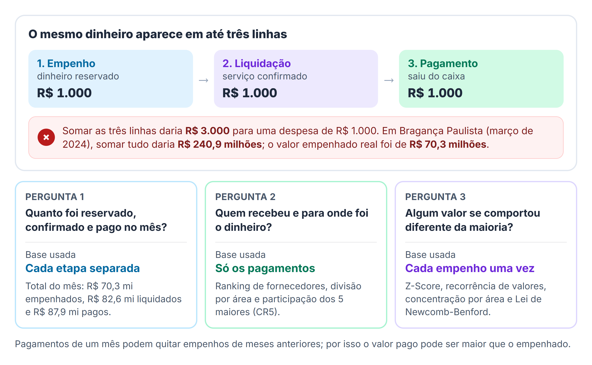

---

## 7. Casos de uso

### 7.1 Diagrama

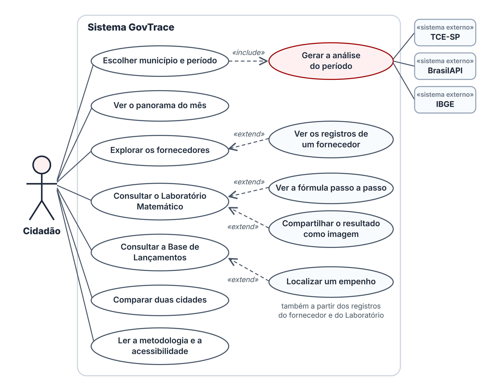

### 7.2 Lista

| ID | Caso de uso | Ator | Requisitos |
|---|---|---|---|
| UC01 | Escolher município e período | Cidadão | RF01 |
| UC02 | Gerar a análise do período (interno) | TCE-SP, BrasilAPI, IBGE | RF02–RF11 |
| UC03 | Ver o panorama do mês | Cidadão | RF02, RF03 |
| UC04 | Explorar os fornecedores | Cidadão | RF04 |
| UC05 | Ver os registros de um fornecedor | Cidadão | RF05 |
| UC06 | Consultar o Laboratório Matemático | Cidadão | RF06 |
| UC07 | Ver a fórmula passo a passo | Cidadão | RF07 |
| UC08 | Compartilhar um resultado como imagem | Cidadão | RF08 |
| UC09 | Consultar a Base de Lançamentos | Cidadão | RF09 |
| UC10 | Localizar um empenho | Cidadão | RF10 |
| UC11 | Comparar duas cidades | Cidadão | RF11 |
| UC12 | Ler a metodologia e a acessibilidade | Cidadão | RF12 |

### 7.3 Descrições

#### UC01 — Escolher município e período

| | |
|---|---|
| **Ator** | Cidadão |
| **Pré-condição** | Site aberto; lista de municípios carregada do IBGE |
| **Pós-condição** | A análise do período é exibida nas cinco abas |

**Fluxo principal**
1. O cidadão digita ou escolhe o município.
2. Escolhe o ano e o mês.
3. O sistema executa o UC02 e mostra o carregamento animado.
4. O sistema exibe a aba “A Cidade” com os dados do período.

**Fluxos alternativos**
- *3a. Consulta já feita na sessão:* o sistema usa a cópia guardada e mostra os dados na hora.
- *3b. O usuário troca o filtro durante a consulta:* a consulta anterior é cancelada e uma nova começa.
- *4a. O TCE-SP não publicou registros:* o sistema informa que não há dados para o período.
- *4b. Falha na consulta:* o sistema mostra a mensagem do erro e permite tentar de novo.

#### UC02 — Gerar a análise do período (interno)

| | |
|---|---|
| **Atores** | TCE-SP, BrasilAPI, IBGE (sistemas externos) |
| **Pré-condição** | Município, ano e mês válidos |
| **Pós-condição** | JSON com totais, divisão por área, ranking, resultados dos métodos e registros |

**Fluxo principal**
1. A API valida os parâmetros.
2. Busca as despesas no TCE-SP (espera até 30 s).
3. Limpa os dados: converte valores, deixa anulações negativas, padroniza etapas e corrige caracteres.
4. Classifica os fornecedores pela atividade oficial (CNAE), com prazo de 8 s.
5. Monta as três bases (etapas, pagamentos, um registro por empenho) e calcula os cinco métodos.
6. Devolve a resposta.

**Exceções**
- *1a. Parâmetro inválido:* erro 400 `PARAMETRO_INVALIDO`, indicando qual parâmetro.
- *2a. TCE-SP não respondeu:* erro 504 `TCE_TIMEOUT`.
- *2b. TCE-SP recusou ou está fora do ar:* erro 502 `TCE_ERRO_HTTP` ou `TCE_INDISPONIVEL`.
- *2c. Formato inesperado:* erro 502 `TCE_FORMATO_INESPERADO` (a análise é interrompida para não mostrar números errados).
- *4a. BrasilAPI lenta ou fora do ar:* os fornecedores sem resposta são classificados pelo nome; a análise continua.

#### UC03 — Ver o panorama do mês

| | |
|---|---|
| **Ator** | Cidadão |
| **Pré-condição** | UC01 concluído |
| **Pós-condição** | O cidadão sabe quanto foi empenhado, liquidado e pago, e para onde foi o dinheiro |

**Fluxo principal**
1. O sistema mostra o total empenhado, contando até o valor real, com o valor exato e a equivalência em salários mínimos.
2. Mostra as três etapas lado a lado, os empenhos do período, o maior valor único e o CR5.
3. Mostra a divisão dos pagamentos por área em uma rosca e em uma lista.
4. O cidadão abre “Entenda estes números” para ler a explicação.

**Fluxo alternativo**
- *3a. O cidadão passa o mouse ou toca em uma área:* a fatia correspondente fica em destaque na rosca.

#### UC04 — Explorar os fornecedores

| | |
|---|---|
| **Ator** | Cidadão |
| **Pré-condição** | UC01 concluído |
| **Pós-condição** | O cidadão encontra os fornecedores que mais receberam |

**Fluxo principal**
1. O sistema mostra os 20 fornecedores que mais receberam, pelo valor pago, com área, pagamentos e participação.
2. O cidadão busca pelo nome ou filtra por área.
3. O cidadão toca em “Mostrar mais” para ver os próximos 20.

**Fluxo alternativo**
- *2a. Nenhum fornecedor encontrado:* o sistema sugere outro nome ou “Todas as áreas”.

#### UC05 — Ver os registros de um fornecedor (estende UC04)

**Fluxo principal**
1. O cidadão toca em um fornecedor.
2. O sistema abre o painel com CNPJ, área, empenhos e registros, o caminho do dinheiro e os órgãos atendidos.
3. O sistema lista os empenhos, do maior para o menor, com a linha do tempo das etapas.
4. O cidadão pode tocar em “Ver na Base de Lançamentos” (UC10).

#### UC06 — Consultar o Laboratório Matemático

| | |
|---|---|
| **Ator** | Cidadão |
| **Pré-condição** | UC01 concluído |
| **Pós-condição** | O cidadão vê os cinco métodos, cada um com seu resultado e explicação |

**Fluxo principal**
1. O sistema carrega as cenas animadas, sob demanda.
2. Para cada método, mostra a pergunta, a cena, o número principal, “Como ler esta cena” e o status (“Destaque estatístico” ou “Dentro do esperado”).
3. Em “Seguir o rastro do empenho”, lista os documentos com identidade anônima do credor.
4. O cidadão pode localizar o empenho (UC10) ou copiar o número e abrir o portal do TCE-SP.

**Fluxo alternativo**
- *2a. Poucos dados para o método:* a cena informa que não há registros suficientes.

#### UC07 — Ver a fórmula passo a passo (estende UC06)

1. Na cena do Z-Score ou de Benford, o cidadão toca em “Ver a fórmula passo a passo”.
2. O sistema carrega o KaTeX e anima a fórmula com os números reais do período.

#### UC08 — Compartilhar um resultado como imagem (estende UC06)

1. O cidadão toca no ícone de compartilhar de uma cena.
2. O sistema gera uma imagem com município, período, número principal e explicação.
3. O cidadão baixa a imagem ou, no celular, compartilha direto pelo aplicativo do aparelho.

#### UC09 — Consultar a Base de Lançamentos

| | |
|---|---|
| **Ator** | Cidadão |
| **Pré-condição** | UC01 concluído |
| **Pós-condição** | O cidadão encontra os registros oficiais que procura |

**Fluxo principal**
1. O sistema lista os registros (25 por vez), dos mais recentes para os mais antigos.
2. O cidadão busca por fornecedor, empenho ou órgão.
3. O cidadão filtra por etapa; o sistema mostra quantos registros e a soma daquela etapa.
4. O cidadão muda a ordem (mais recentes, mais antigos, maior valor).

**Fluxo alternativo**
- *3a. Nenhuma etapa escolhida:* o sistema não mostra soma, para não somar o mesmo dinheiro em etapas diferentes.

#### UC10 — Localizar um empenho (estende UC09)

1. O cidadão toca no número de um empenho (na tabela, no painel do fornecedor ou no Laboratório).
2. O sistema abre a Base de Lançamentos com o empenho em foco: o número, o órgão, a linha do tempo das etapas e só as linhas daquele documento.
3. O cidadão toca em “Ver todos os lançamentos” para voltar à lista completa.

#### UC11 — Comparar duas cidades

| | |
|---|---|
| **Ator** | Cidadão |
| **Pré-condição** | Período escolhido no topo da página |
| **Pós-condição** | Placar das duas cidades no mesmo mês |

**Fluxo principal**
1. A Cidade A já vem preenchida com o município consultado.
2. O cidadão escolhe a Cidade B; o sistema executa o UC02 para ela.
3. O sistema mostra a frase-resumo e o placar: total empenhado, valor pago, empenhos, CR5 e maior área.

**Fluxos alternativos**
- *2a. Cidade B ainda não escolhida:* o sistema mostra um convite para escolher.
- *2b. O cidadão troca as cidades de lugar:* o placar é refeito com A e B invertidas.
- *3a. Uma cidade sem dados ou com erro:* o lado correspondente mostra o aviso, e o outro continua visível.

#### UC12 — Ler a metodologia e a acessibilidade

1. O cidadão abre “Metodologia”, “Acessibilidade” ou “Sobre o projeto” no cabeçalho ou no rodapé.
2. O sistema mostra a janela com o conteúdo; no celular, ela ocupa a tela inteira.

---

## 8. Arquitetura

### 8.1 Estilo arquitetural

- **Cliente-servidor desacoplado:** o site só apresenta; a API concentra regras e cálculos.
- **API REST** com resposta em JSON.
- **API em camadas:** rotas → serviços (acesso a TCE-SP, BrasilAPI e IBGE) → domínio puro (sem I/O, testável isoladamente).
- **Site em componentes React**, um conjunto por aba, orquestrados por uma página única (`Painel`).

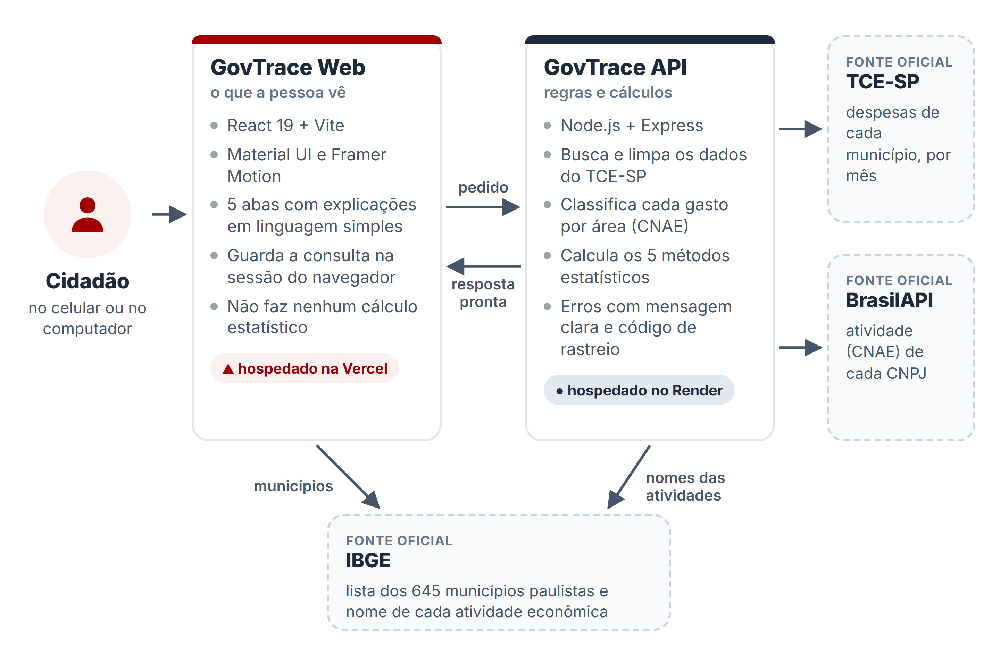

### 8.2 Componentes do site (GovTrace Web)

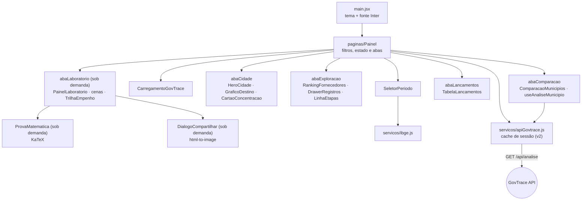

### 8.3 Componentes da API (GovTrace API)

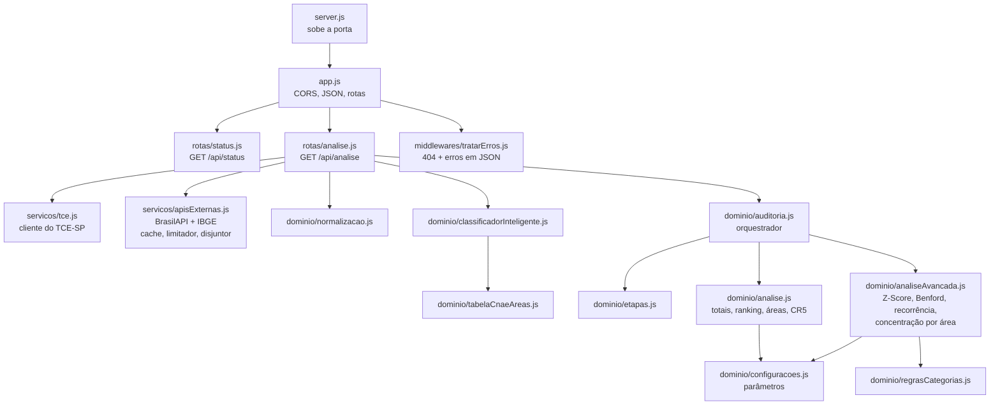

### 8.4 Fluxo de uma consulta

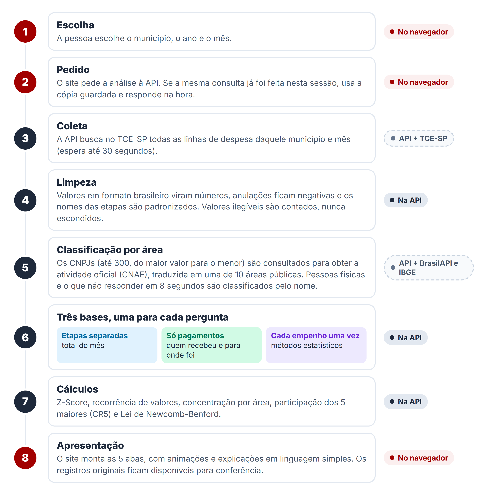

---

## 9. Modelagem UML

### 9.1 Diagrama de sequência — consulta de um período

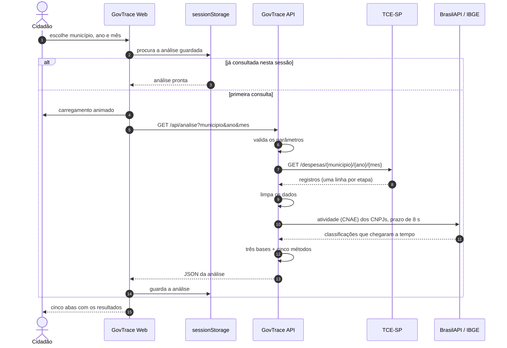

### 9.2 Diagrama de atividades — processamento na API

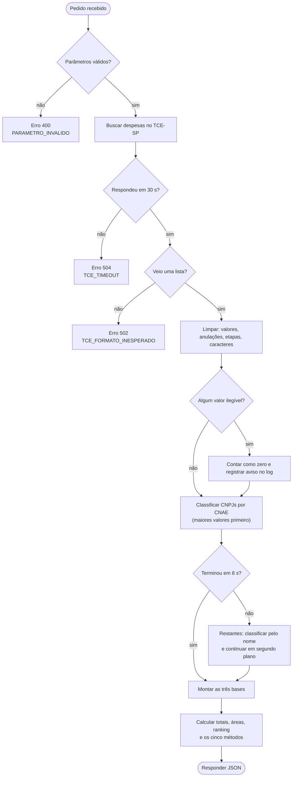

### 9.3 Diagrama de estados — uma consulta no site

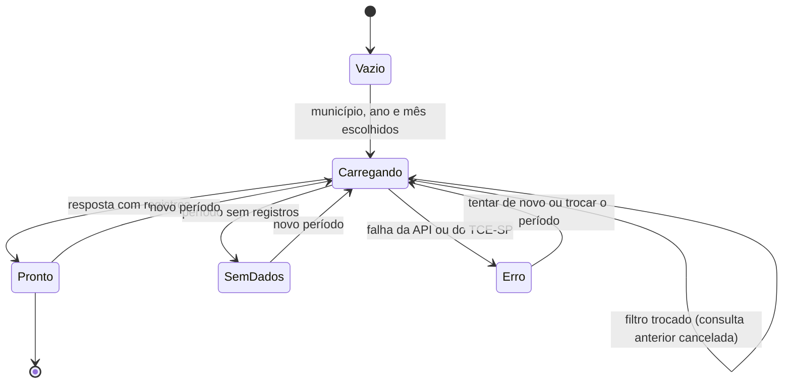

### 9.4 Diagrama de classes — modelo de domínio

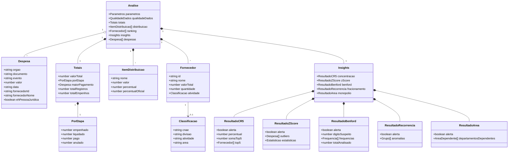

> Os nomes `fracionamento`, `monopolio` e `anomalias` são os campos da API; na interface, eles aparecem como recorrência de valores e concentração por área.

### 9.5 Diagrama de implantação

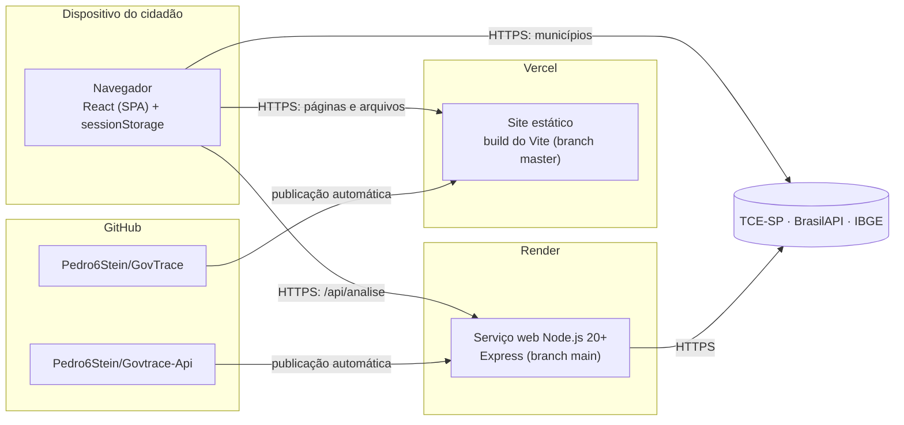

---

## 10. Contrato da API

URL base em produção: `https://govtrace-api.onrender.com`

### 10.1 `GET /api/status`

Verifica se a API está no ar.

```json
{ "status": "ok", "servico": "govtrace-api", "uptimeSegundos": 310, "timestamp": "2026-10-22T18:29:31.354Z" }
```

### 10.2 `GET /api/analise`

| Parâmetro | Tipo | Obrigatório | Regra | Exemplo |
|---|---|---|---|---|
| `municipio` | texto | sim | Nome do município paulista | `Bragança Paulista` |
| `ano` | texto | sim | 4 dígitos | `2024` |
| `mes` | número | sim | 1 a 12 | `3` |

```
GET /api/analise?municipio=Bragança%20Paulista&ano=2024&mes=3
```

**Resposta 200** — exemplo real (Bragança Paulista, março de 2024, consultado em 23/10/2026), resumido:

```json
{
  "parametros": { "municipio": "Bragança Paulista", "ano": "2024", "mes": "3" },
  "qualidadeDados": {
    "registrosRecebidos": 3862,
    "registrosAnalisados": 3862,
    "valoresInvalidos": 0,
    "classificacao": {
      "cnpjsUnicos": 382, "cnpjsConsultados": 300, "cnpjsComCnae": 100, "cnpjsComArea": 94,
      "percentualValorClassificado": 93.48, "concluiuNoPrazo": true, "tempoMs": 5497
    }
  },
  "totais": {
    "valorTotal": 70303256.27,
    "porEtapa": { "empenhado": 70303256.27, "liquidado": 82649473.53, "pago": 87945605.51, "anulado": -4396074.14 },
    "maiorPagamento": { "documento": "002204-2024", "evento": "Liquidado", "data": "04/03/2024", "valor": 6259870.69 },
    "totalRegistros": 3862,
    "totalEmpenhos": 2050
  },
  "distribuicao": [
    { "nome": "Máquina Pública, Repasses e Encargos", "valor": 36759369.59, "percentual": 41.8, "percentualOficial": 100 }
  ],
  "ranking": [
    {
      "id": "46384111000140", "nome": "…", "valorTotal": 12519741.38, "quantidade": 2,
      "atividade": { "cnae": "8412400", "divisao": "84", "atividade": "Administração pública, defesa e seguridade social", "area": "Máquina Pública, Repasses e Encargos" }
    }
  ],
  "insights": {
    "concentracao": { "alerta": true, "percentual": 33.51, "somaTop5": 29470559.71, "top5": ["…"] },
    "zScore": {
      "alerta": true, "outliers": ["… 15 empenhos …"],
      "estatisticas": { "media": 85734.61, "desvioPadrao": 398323.0, "totalAnalisado": 1403, "limite": 4, "exemploValor": 6259870.69 }
    },
    "benford": { "alerta": false, "digitoSuspeito": null, "frequencias": ["… 9 dígitos …"], "totalAnalisado": 1397, "limiarDesvio": 5 },
    "fracionamento": { "alerta": true, "anomalias": [{ "nome": "…", "valor": 1776.47, "repeticoes": 5 }, { "nome": "…", "valor": 3113.13, "repeticoes": 5 }] },
    "monopolio": {
      "alerta": true,
      "departamentosDependentes": [
        { "orgao": "Transporte, Frotas e Mobilidade", "empresa": "…", "percentual": 58.34 },
        { "orgao": "Alimentação e Abastecimento", "empresa": "…", "percentual": 88.28 }
      ]
    }
  },
  "despesas": [
    { "orgao": "PREFEITURA MUNICIPAL DE BRAGANÇA PAULISTA", "evento": "Empenhado", "documento": "002824-2024", "fornecedorId": "…", "fornecedorNome": "…", "ehPessoaJuridica": true, "data": "06/03/2024", "valor": 2000 }
  ]
}
```

> Listas foram cortadas e nomes de fornecedores substituídos por `…` neste documento. A divisão por área pode variar alguns décimos entre consultas (veja RN10 e ADR-04). Cada objeto de `insights` também traz `titulo` e textos explicativos.

### 10.3 Erros

Todos os erros seguem o mesmo formato:

```json
{ "erro": "mensagem para a pessoa", "status": 504, "codigo": "TCE_TIMEOUT", "idErro": "a1b2c3d4", "detalhes": { }, "timestamp": "…" }
```

| Status | Código | Quando acontece |
|---|---|---|
| 400 | `PARAMETRO_INVALIDO` | Município vazio, ano sem 4 dígitos ou mês fora de 1 a 12 (`detalhes.parametro` indica qual) |
| 404 | `ROTA_INEXISTENTE` | Endereço que não existe na API |
| 502 | `TCE_ERRO_HTTP` | O TCE-SP recusou a consulta |
| 502 | `TCE_INDISPONIVEL` | Não foi possível conectar ao TCE-SP |
| 502 | `TCE_FORMATO_INESPERADO` | O TCE-SP não devolveu uma lista; a análise é interrompida |
| 504 | `TCE_TIMEOUT` | O TCE-SP não respondeu em 30 segundos |
| 500 | `ERRO_INTERNO` | Falha inesperada; em produção, a mensagem traz só o `idErro`, que liga ao log completo |

### 10.4 CORS

A API só libera a leitura para as origens configuradas em `CORS_ORIGIN` (em produção, o site da Vercel). Pedidos sem cabeçalho `Origin` (curl, verificação de saúde) são atendidos normalmente.

---

## 11. Modelo de dados

### 11.1 Registro de despesa (após a limpeza)

| Campo | Tipo | Campo no TCE-SP | Descrição |
|---|---|---|---|
| `orgao` | texto | `orgao` | Órgão que registrou a despesa |
| `documento` | texto | `nr_empenho` | Número do empenho; liga as etapas do mesmo documento |
| `evento` | texto | `evento` | `Empenhado`, `Reforço`, `Anulação`, `Liquidado` ou `Pago` |
| `valor` | número | `vl_despesa` | Valor em reais; negativo nas anulações |
| `data` | texto | `dt_emissao_despesa` | Data do registro (dd/mm/aaaa) |
| `fornecedorId` | texto | `id_fornecedor` | CNPJ, ou CPF mascarado pelo TCE-SP, só com dígitos |
| `fornecedorNome` | texto | `nm_fornecedor` | Nome do fornecedor, com caracteres especiais corrigidos |
| `ehPessoaJuridica` | lógico | `id_fornecedor` | Empresa (CNPJ) ou pessoa física |

### 11.2 Armazenamento

O GovTrace **não tem banco de dados**. Os dados ficam só em memória ou na sessão do navegador:

| Onde | O quê | Quanto tempo |
|---|---|---|
| `sessionStorage` do navegador | Análise completa, na chave `govtrace_analise_v2_{municipio}_{ano}_{mes}` | Até fechar a aba |
| Memória da API | Classificação de até 20.000 CNPJs e de 200 divisões do CNAE | Até a API reiniciar |

---

## 12. Decisões de arquitetura

| ID | Data | Decisão | Por quê | Consequência |
|---|---|---|---|---|
| ADR-01 | 29/09/2026 | Separar site e API | O navegador baixava milhares de registros e calculava tudo, pesando no celular | Regras em um só lugar e testáveis; a API pode servir outros clientes |
| ADR-02 | set/2026 | Não usar banco de dados | Os dados oficiais já estão no TCE-SP; guardar cópia exigiria rotina de atualização | Análise sempre atual, mas dependente da disponibilidade do TCE-SP |
| ADR-03 | set/2026 | Cache de sessão no navegador | Voltar a um período já visto não deve repetir a consulta | Chave versionada (`v2`) para invalidar quando o formato muda |
| ADR-04 | 17/10/2026 | Classificar por CNAE oficial, com prazo e reserva pelo nome | Classificação só pelo nome errava áreas; a BrasilAPI tem limite de uso | Mais precisão; a divisão por área pode variar alguns décimos entre consultas |
| ADR-05 | 18/10/2026 | Carregar Laboratório, fórmulas e imagem sob demanda | Framer Motion, KaTeX e html-to-image pesariam na primeira visita | Primeira tela mais leve; uma breve espera ao abrir essas partes |
| ADR-06 | 21/10/2026 | Identidade anônima dos credores no Laboratório | Recomendação da banca: evitar exposição e interpretações fora de contexto | O destaque é o número do empenho, conferível na Base e no TCE-SP |
| ADR-07 | 22/10/2026 | Uma base para cada pergunta | Somar todas as linhas contava o mesmo dinheiro até três vezes | Totais corretos; ordem de publicação: API antes do site |
| ADR-08 | set/2026 | Hospedagem gratuita (Vercel + Render) | Projeto acadêmico, sem orçamento | Primeira consulta após inatividade pode levar ~50 s |

---

## 13. Qualidade e plano de testes

### 13.1 Estratégia

| Nível | Ferramenta | Quando |
|---|---|---|
| Testes automatizados (unidade e integração do domínio) | `node --test` na API | Antes de cada entrega da API |
| Análise estática | ESLint 9 no site | Antes de cada entrega do site |
| Compilação de produção | `vite build` | Antes de cada entrega do site |
| Testes manuais no navegador | Computador e celular (360 px) | A cada mudança visual |

### 13.2 Testes automatizados da API (40)

| Arquivo | Testes | O que garante |
|---|---|---|
| `etapas.test.js` | 7 | Etapas separadas; um registro por empenho; ranking e CR5 pelo valor pago; nada somado em dobro |
| `classificadorInteligente.test.js` | 10 | Ordem por valor, respeito ao prazo, falha externa sem derrubar a análise, área oficial antes do nome |
| `tabelaCnaeAreas.test.js` | 11 | Busca do mais específico ao mais geral e cobertura contra a lista oficial do IBGE |
| `texto.test.js` | 7 | Correção de caracteres especiais nos nomes, sem alterar acentos |
| `analiseAvancada.test.js` | 5 | Estatísticas do Z-Score e frequências de Benford usadas na fórmula passo a passo |

### 13.3 Casos de teste manuais

Dados de referência: **Bragança Paulista, março de 2024**.

| ID | Requisito | Passos | Resultado esperado |
|---|---|---|---|
| CT01 | RF01 | Escolher 2024, Março e digitar “Bragança” | Opção “Bragança Paulista” aparece; ao escolher, surge o carregamento animado |
| CT02 | RF02 | Abrir “A Cidade” | Empenhado R$ 70,3 mi; liquidado R$ 82,6 mi; pago R$ 87,9 mi; 2.050 empenhos em 3.862 registros |
| CT03 | RF03 | Ver “Para onde foi o dinheiro?” | Total pago R$ 87,9 mi no centro da rosca; maior área: Máquina Pública, Repasses e Encargos (~42%) |
| CT04 | RF04 | Abrir “Exploração” | 375 fornecedores; o 1º recebeu R$ 12,5 mi (14,2% do valor pago) |
| CT05 | RF04 | Buscar “santa casa” | Nenhum resultado (o nome oficial abrevia para “STA CASA”); buscar “sta casa” encontra |
| CT06 | RF05 | Tocar no 1º fornecedor | Painel abre com CNPJ, caminho do dinheiro e empenhos com a linha do tempo |
| CT07 | RF06 | Abrir “Laboratório” | “4 de 5 cenas com destaque”; Z-Score com 15 empenhos; nenhum nome de credor na tela |
| CT08 | RF07 | Tocar em “Ver a fórmula passo a passo” | Fórmula do Z-Score aparece com os números do período |
| CT09 | RF08 | Tocar em compartilhar na cena do Z-Score | Imagem com município, período, “15” e explicação; botão “Baixar imagem” |
| CT10 | RF09 | Abrir “Base de Lançamentos” e filtrar “Pagamento” | 1.478 lançamentos; soma dos pagamentos R$ 87.945.605,51 |
| CT11 | RF09 | Voltar para “Todas as etapas” | A soma some e aparece “Escolha uma etapa para ver a soma dos valores” |
| CT12 | RF10 | Tocar em um número de empenho | “Empenho em foco” com a linha do tempo e só as linhas do documento |
| CT13 | RF11 | Abrir “Comparação” e escolher Atibaia | “valores parecidos”; R$ 70,3 mi × R$ 67,7 mi; CR5 33,5% × 22,7% |
| CT14 | RNF03 | Repetir CT02, CT04 e CT10 com 360 px de largura | Sem rolagem lateral; Base de Lançamentos em cartões |
| CT15 | RNF04 | Ativar “reduzir movimento” no sistema e recarregar | Nenhuma animação; números aparecem direto no valor final |
| CT16 | RNF08 | Consultar com a API desligada | Mensagem de erro clara, sem números na tela |

### 13.4 Como rodar

```bash
# Site
npm run lint
npm run build

# API (no repositório Govtrace-Api)
npm test
```

---

## 14. Segurança, privacidade e acessibilidade

### 14.1 Privacidade (LGPD)

- Nenhum cadastro, login, cookie de rastreamento ou ferramenta de analytics.
- Os dados exibidos são públicos e já publicados pelo TCE-SP, que mascara o CPF de pessoas físicas.
- No Laboratório, o credor aparece só como “Empresa do Setor de X • Final #1234” ou “Credor Pessoa Física • Ref. #1234”.

### 14.2 Segurança

- Validação de todos os parâmetros na API (erro 400 com o parâmetro exato).
- CORS restrito à origem do site.
- Em produção, erros internos não expõem detalhes, só o código de rastreio (`idErro`).
- Tempo máximo de espera nas fontes externas (30 s no TCE-SP, 6 s na BrasilAPI e no IBGE).
- Uso responsável das APIs gratuitas: limite de consultas simultâneas, pausa automática quando a BrasilAPI indica excesso de pedidos (HTTP 429) e identificação do GovTrace no cabeçalho `User-Agent`.

### 14.3 Acessibilidade (WCAG 2.1 AA)

- Contraste mínimo de 4,5:1 nos textos e de 3:1 nas bordas de campos.
- Navegação completa por teclado e atalho “Pular para o conteúdo”.
- Títulos hierárquicos, abas e explicações que anunciam o estado (aberto ou fechado); números abreviados lidos por extenso.
- Áreas de toque de pelo menos 44 px.
- Layout até 320 px e zoom de 200%, sem rolagem horizontal.
- Animações desligadas quando o sistema pede menos movimento.
- Cor nunca é o único sinal: todo status tem ícone e texto.

### 14.4 Linguagem neutra

Os resultados são “destaques estatísticos”, nunca irregularidades. Termos como “auditoria”, “suspeita”, “fraude” ou “fracionamento” não aparecem para o cidadão. Todo destaque vem com a explicação do que pode causá-lo (por exemplo, obras e contratos anuais).

---

## 15. Implantação e operação

### 15.1 Ambientes

| Ambiente | Site | API |
|---|---|---|
| Local | `http://localhost:5173` (`npm run dev`) | `http://localhost:3333` (`npm run dev`) |
| Produção | Vercel — branch `master` | Render — branch `main` |

### 15.2 Variáveis de ambiente

| Onde | Variável | Uso | Padrão |
|---|---|---|---|
| Site | `VITE_API_URL` | Endereço do `/api/analise` | `https://govtrace-api.onrender.com/api/analise` |
| API | `PORT` | Porta do servidor | `3333` |
| API | `CORS_ORIGIN` | Origens autorizadas (separadas por vírgula) | `http://localhost:5173` |
| API | `NODE_ENV` | `production` esconde detalhes de erros internos | — |

### 15.3 Rodar localmente

```bash
# API
git clone https://github.com/Pedro6Stein/Govtrace-Api.git
cd Govtrace-Api && npm install && npm run dev

# Site (em outro terminal), com .env.local apontando para a API local
git clone https://github.com/Pedro6Stein/GovTrace.git
cd GovTrace && npm install
echo VITE_API_URL=http://localhost:3333/api/analise > .env.local
npm run dev
```

### 15.4 Publicação

1. A mudança entra na branch principal por Pull Request.
2. A Vercel (site) ou o Render (API) publica automaticamente.
3. **Quando o formato da resposta da API muda**, publica-se a API primeiro e o site depois.

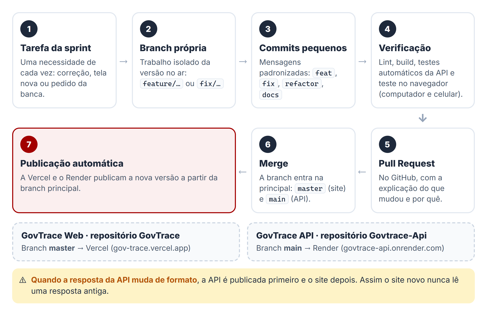

### 15.5 Monitoramento

- `GET /api/status` informa se a API está no ar e há quanto tempo.
- Cada erro gera um bloco de log no Render com o `idErro`, o motivo e o endereço consultado no TCE-SP.
- Valores ilegíveis vindos do TCE-SP geram um aviso no log com município e período.

---

## 16. Processo e gestão de configuração

### 16.1 Processo

Ciclos curtos (sprints), cada um com uma entrega pequena e verificável. Cada mudança segue o fluxo: **branch própria → commits pequenos → verificação → Pull Request → merge → publicação automática**.

- Branches de produção: `master` (site) e `main` (API).
- Branches de trabalho: `feature/…`, `fix/…` e `docs/…`.
- Mensagens de commit no padrão Conventional Commits: `feat`, `fix`, `refactor`, `docs`, `chore`, `test`.

A branch `principal` do diagrama é a `master` no site e a `main` na API.

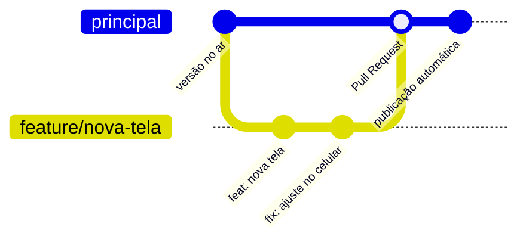

### 16.2 Cronograma realizado

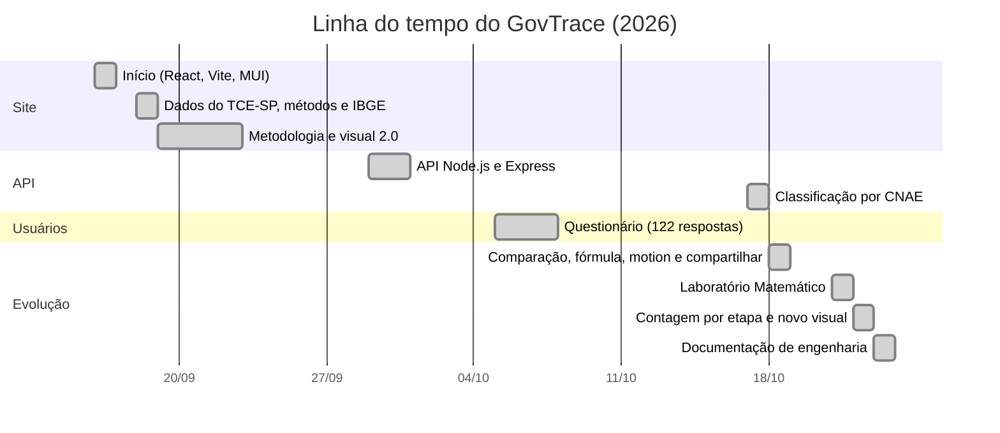

---

## 17. Matriz de rastreabilidade

| Necessidade (questionário) | Requisitos | Casos de uso | Onde no código | Testes |
|---|---|---|---|---|
| Não saber onde procurar (43,4%) | RF01, RF02 | UC01, UC03 | `paginas/Painel`, `abaCidade/HeroCidade.jsx` | CT01, CT02 |
| Sites lentos ou confusos (34,4%) | RNF07, RNF01 | UC01 | `servicos/apiGovtrace.js`, `CarregamentoGovTrace` | CT01 |
| Linguagem burocrática (20,5%) | RNF01, RF12 | UC03, UC12 | `ExplicacaoCidada`, `ModalMetodologia` | CT02 |
| Saber quem mais recebe (95,1%) | RF04, RF05 | UC04, UC05 | `abaExploracao/RankingFornecedores.jsx` | CT04–CT06 |
| Acesso pelo celular (54,9%) | RNF03 | todos | layout responsivo, `TabelaLancamentos.jsx` | CT14 |
| Rápida, sem instalar (58,2%) | RNF02 | UC01 | aplicação web na Vercel | CT01 |
| Dados neutros (41,8%) | RNF05, RF06 | UC06 | `abaLaboratorio/rastro.js` | CT07 |
| Documento oficial (24,6%) | RF09, RF10, RNF06 | UC09, UC10 | `abaLancamentos/TabelaLancamentos.jsx` | CT10–CT12 |
| Compartilhar o que encontrar (30,3%) | RF08 | UC08 | `abaLaboratorio/DialogoCompartilhar.jsx` | CT09 |
| Saúde e obras com clareza (64,8%) | RF03 | UC03 | `abaCidade/GraficoDestino.jsx`; API `tabelaCnaeAreas.js` | CT03 |
| Comparar meses ou anos (92,6%) | — (planejado) | — | — | — |

---

## 18. Riscos e limitações

| Risco / limitação | Impacto | Mitigação |
|---|---|---|
| TCE-SP lento ou fora do ar | Consulta não completa | Espera de 30 s, mensagem clara e opção de tentar de novo |
| Mudança no formato do TCE-SP | Números errados | A análise é interrompida (`TCE_FORMATO_INESPERADO`) |
| Limite da BrasilAPI | Classificação incompleta | Ordem por valor, prazo de 8 s, cache e pausa automática; reserva pelo nome |
| API “dormindo” no plano gratuito | Primeira consulta em ~50 s | Carregamento animado que explica a espera; abrir o site antes de demonstrações |
| Mesmo fornecedor com matriz e filiais | Ranking dividido | O ranking agrupa pelo CNPJ/CPF, não pelo nome; filiais com CNPJ próprio ainda aparecem separadas |
| Interpretação equivocada de um destaque | Exposição injusta | Linguagem neutra, explicação das causas comuns e identidade anônima no Laboratório |
| Cache cheio no navegador | Sem cópia da análise | Leitura e escrita protegidas; a consulta segue pela rede |
| Sem série histórica | Não compara meses | Registrado como trabalho futuro |

---

## 19. Glossário

| Termo | Significado |
|---|---|
| **Empenho** | Reserva de parte do orçamento para uma despesa; ainda não é pagamento |
| **Liquidação** | Confirmação de que o serviço foi prestado ou o produto entregue |
| **Pagamento** | Saída do dinheiro do caixa para o fornecedor |
| **Reforço / Anulação** | Acréscimo / cancelamento de parte de um empenho |
| **CNAE** | Classificação Nacional de Atividades Econômicas: o código oficial do que uma empresa faz |
| **CR5** | Parcela do total pago que ficou com os 5 maiores fornecedores |
| **Z-Score** | Quantos desvios padrão um valor está acima da média |
| **Lei de Newcomb-Benford** | Distribuição esperada do primeiro dígito em dados financeiros reais |
| **Destaque estatístico** | Valor que se comporta diferente da maioria; não é prova de irregularidade |
| **API** | Interface que permite a um sistema pedir dados a outro |
| **SPA** | Aplicação de página única: o site troca de tela sem recarregar a página |
| **CORS** | Regra do navegador que define quais sites podem ler as respostas de uma API |
| **Cold start** | Tempo que um servidor gratuito leva para “acordar” depois de um período sem uso |

---

## 20. Histórico do documento

| Versão | Data | Alteração | Autores |
|---|---|---|---|
| 1.0 | 23/10/2026 | Versão inicial, a partir do código do site e da API | Equipe GovTrace |
